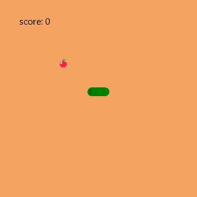
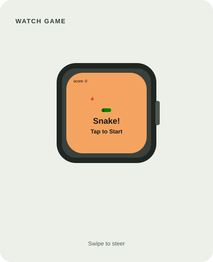
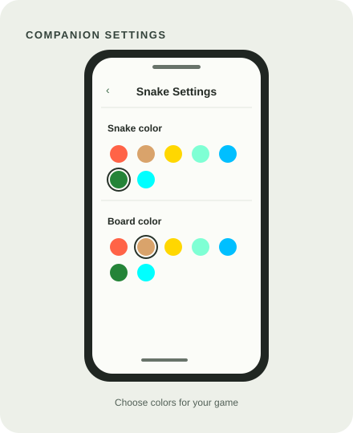

# Snake for Fitbit Versa 2

A classic Snake game for your Fitbit watch. Swipe to guide the snake, eat apples to grow, and see how high you can score without hitting the wall or yourself.

## Screenshots

### Gameplay

| Watch game | Companion settings |
| --- | --- |
|  |  |

These are source-based previews of the app UI, not captures from a Fitbit emulator. The rendered appearance may vary slightly by device.

## How to play

- Tap the watch screen to start.
- Swipe up, down, left, or right to change direction.
- Eat apples to increase your score and grow the snake.
- Avoid the edge of the play area and the snake's own body. A collision ends the round; a new round is ready after a short pause.

## Settings

Open the app's settings from the Fitbit mobile app to choose a snake color and a board color. The companion app sends changes to the watch.

## Build and install

This project uses Fitbit OS SDK `~6.0.0` and declares the `atlas` and `vulcan` build targets in `package.json`.

1. Install Node.js and npm, then install the project dependencies with `npm install`.
2. Install and open the Fitbit SDK CLI.
3. Use the CLI to build the app for a target supported by your device, then install and launch it on a paired watch or compatible simulator.

The project includes KPay purchase and trial integration. Configure the corresponding KPay product and trial settings before distributing a build.